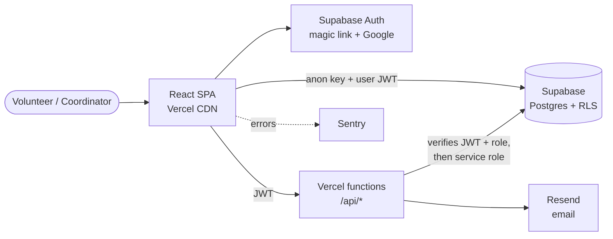
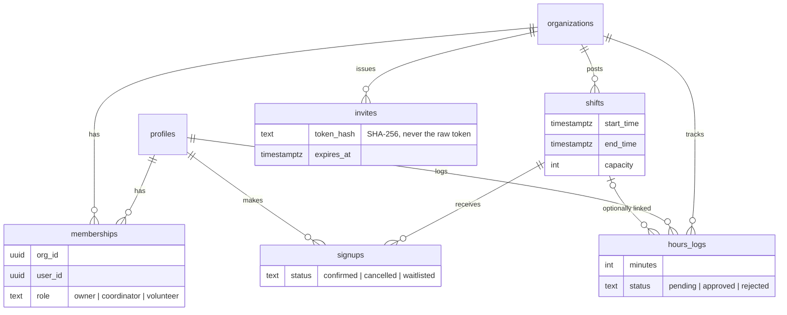

# ShowingUp

**Volunteer scheduling for small nonprofits, without the spreadsheets and group texts.**

ShowingUp lets an organization post volunteer shifts, lets volunteers claim open spots from their
phone, and gives coordinators an approval queue for logged hours and exportable reports. It is
multi-tenant: a person can volunteer at one organization and coordinate at another, with
permissions enforced by the database itself rather than by the UI.

> **Live demo:** _coming with the MVP_ · **Screenshots:** _coming with the MVP_

---

## Project status

🚧 **In active development: Phase 0 (Foundation).** This README is updated with every merged PR.

| Phase                | Scope                                                                                              | Status         |
| -------------------- | -------------------------------------------------------------------------------------------------- | -------------- |
| **0. Foundation**    | Tooling, test harness, CI/CD, database, app shell                                                  | 🔄 In progress |
| **P0. MVP**          | Auth, organizations, invites, shifts, claiming shifts, role-based navigation, demo data            | ⏳ Planned     |
| **P1. Full product** | Hours approval, week calendar, recurring shifts, reports & CSV export, email reminders, monitoring | ⏳ Planned     |
| **P2. Stretch**      | Waitlists, skills matching, realtime spot counts, offline PWA, dark mode                           | ⏳ Planned     |

<details>
<summary><strong>Phase 0 checklist</strong></summary>

- [x] **0.1** Repository & tooling: Vite, strict TypeScript, ESLint (type-aware + a11y), Prettier, Tailwind, shadcn/ui
- [x] **0.2** Test harness: Vitest, React Testing Library, MSW, jest-axe, shared render helper
- [ ] **0.3** CI/CD: GitHub Actions, Vercel previews, branch protection, Dependabot
- [ ] **0.4** Database: local Supabase stack, first migration, RLS, generated types
- [ ] **0.5** App shell: router, layouts, providers, error boundaries, loading/empty states

</details>

---

## Demo accounts

_Seeded owner, coordinator, and volunteer accounts will be listed here once the MVP is deployed._

---

## Tech stack

The stack as designed. Pieces are added phase by phase; see [Project status](#project-status)
for what has landed so far.

| Concern          | Choice                                    | Why                                                                                   |
| ---------------- | ----------------------------------------- | ------------------------------------------------------------------------------------- |
| Build            | Vite 8 + React 19 + TypeScript 6 (strict) | Fast builds, mature ecosystem, strict typing including unchecked index access         |
| Routing          | React Router 8 (data router)              | Route-level code splitting, error boundaries per route, URL as the source of truth    |
| Backend          | Supabase (Postgres, Auth, RLS)            | Real relational modeling with authorization enforced in the database                  |
| Server state     | TanStack Query 5                          | Caching, optimistic updates with rollback, cursor pagination                          |
| Forms            | React Hook Form + Zod 4                   | Typed, performant forms with one schema shared between validation and types           |
| UI               | Tailwind CSS 4 + shadcn/ui (Radix)        | Accessible primitives whose source lives in the repo and can be audited               |
| Dates            | date-fns 4 + @date-fns/tz                 | Timestamps stored in UTC and shown in each organization's time zone                   |
| Unit/integration | Vitest + React Testing Library + MSW 2    | Tests run through the same Vite pipeline as the app; network mocked at the HTTP layer |
| Accessibility    | jest-axe + eslint-plugin-jsx-a11y         | Automated WCAG checks in both lint and tests                                          |
| End-to-end       | Playwright                                | Critical user journeys tested against real preview deployments                        |
| Hosting / CI     | Vercel + GitHub Actions                   | Preview deploy per PR; lint, typecheck, coverage, and build gates before merge        |

Key decisions are recorded as [Architecture Decision Records](docs/adr/).

---

## Architecture

_Planned. This section will be updated as each layer lands._



### Data model (planned)



---

## Security design

_Planned. Implementation details and tests will be linked here as they land._

- **Authorization lives in Postgres.** Row Level Security is enabled on every table; the UI only
  hides controls a user can't use. A volunteer calling the API directly gets the same answer as
  the UI.
- **Race-free shift claiming.** `claim_shift()` locks the shift row (`SELECT … FOR UPDATE`) before
  counting confirmed signups, so two volunteers can't both take the last spot.
- **Sensitive writes go through RPCs.** Memberships, signups, and hour approvals are written only
  by `security definer` functions that check the caller's role.
- **Invite tokens are hashed.** Only a SHA-256 hash is stored; links expire after 7 days and are
  single use.
- **Secrets stay server-side.** The browser only receives the public Supabase URL and anon key;
  the service-role key exists only in Vercel functions.

---

## Testing strategy

_CI and coverage badges will appear here once the pipeline is live (Phase 0.3)._

**In place now**

- **Unit & integration (Vitest + React Testing Library):** behavior-focused tests that query by
  role and label, with `user-event` for realistic keyboard and pointer interaction.
- **Shared render helper:** `renderWithProviders()` mounts components inside the same providers the
  app uses (a fresh TanStack Query client per test and a data router), so tests can drive URLs,
  route params, and search params.
- **Network mocking with MSW:** requests are intercepted at the HTTP layer, so real client code
  runs against fake responses. Any request without a handler **fails the test**, so nothing
  reaches a real network by accident.
- **Accessibility:** page-level tests run an axe audit (`jest-axe`); the harness itself is tested
  to confirm violations are actually reported.
- **Lint rules for tests:** Testing Library best practices are enforced, and focused tests
  (`.only`) are rejected so a suite can't be skipped silently.
- **Coverage gate:** 80% lines on `src/features/**` and `src/lib/**`.

**Planned**

- **Database (pgTAP):** RLS policies tested directly, e.g. a volunteer cannot read another
  organization's shifts or approve their own hours (Phase 0.4).
- **End-to-end (Playwright):** claim a shift, hit a full shift, approve hours, redeem an invite.

---

## Lighthouse

_Targets: ≥ 90 for Performance, Accessibility, and Best Practices on mobile; initial JS < 200 KB
gzipped. Scores will be published after the first production deploy._

---

## Local setup

**Prerequisites:** Node 24 (see `.nvmrc`).

```bash
git clone https://github.com/JeffHenry/showing-up.git
cd showing-up
npm install
npm run dev
```

| Script                  | Purpose                                      |
| ----------------------- | -------------------------------------------- |
| `npm run dev`           | Start the Vite dev server                    |
| `npm run build`         | Type-check and build for production          |
| `npm run typecheck`     | TypeScript project build without emitting    |
| `npm run lint`          | ESLint (type-aware, React Hooks, a11y)       |
| `npm run format`        | Format with Prettier (`format:check` for CI) |
| `npm run test`          | Run unit and integration tests once (Vitest) |
| `npm run test:watch`    | Re-run tests on file changes                 |
| `npm run test:coverage` | Run tests with the coverage gate             |

_Database setup (Docker + Supabase CLI) will be added in Phase 0.4._

---

## Trade-offs & what I'd do next

- **TypeScript 6 and ESLint 9, not the newest majors.** typescript-eslint doesn't yet support
  TypeScript 7, and eslint-plugin-jsx-a11y doesn't yet support ESLint 10. Accessibility linting
  was worth more than being one major version ahead. See [ADR 0001](docs/adr/0001-stack-and-versions.md).
- **Vitest instead of Jest.** Same API and the same Testing Library ecosystem, without a second
  transform pipeline that drifts from the production build.
  See [ADR 0002](docs/adr/0002-vitest-over-jest.md).
- **SPA + Supabase rather than a server-rendered framework.** Simpler hosting and a clear security
  boundary in the database, at the cost of SEO on public pages (not a goal for this app).
