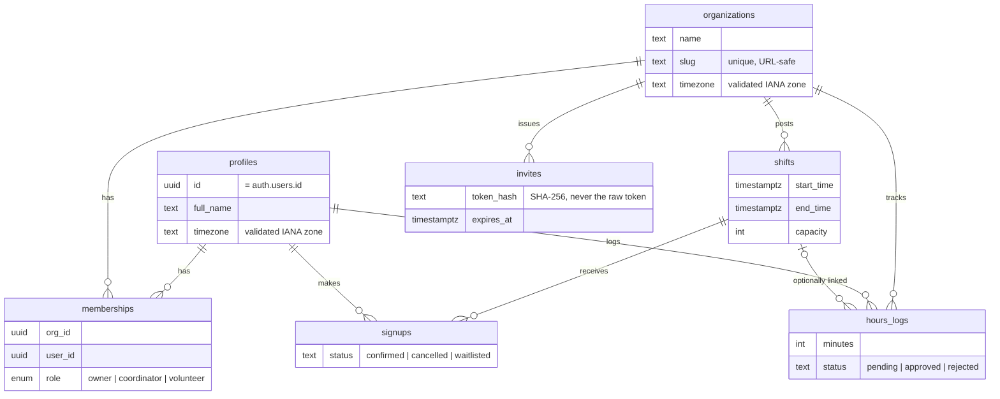
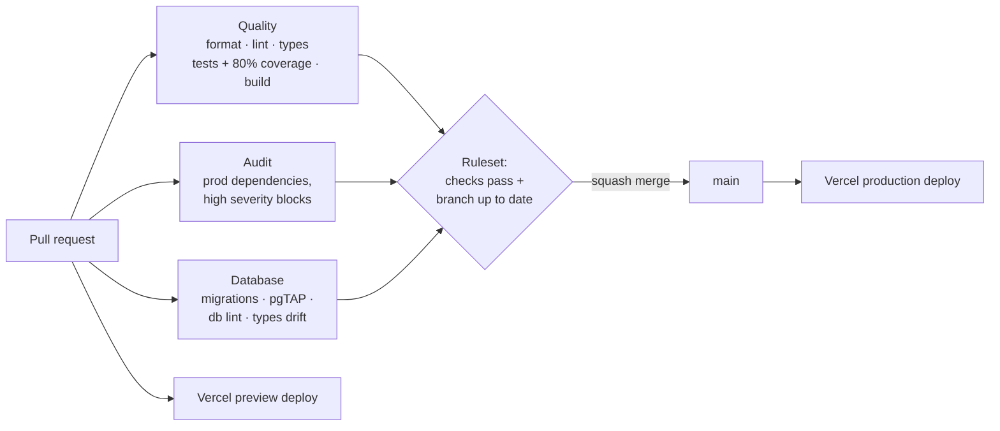

# ShowingUp

[](https://github.com/JeffHenry/showing-up/actions/workflows/ci.yml)
[](https://codecov.io/gh/JeffHenry/showing-up)

**Volunteer scheduling for small nonprofits, without the spreadsheets and group texts.**

ShowingUp lets an organization post volunteer shifts, lets volunteers claim open spots from their
phone, and gives coordinators an approval queue for logged hours and exportable reports. It is
multi-tenant: a person can volunteer at one organization and coordinate at another, with
permissions enforced by the database itself rather than by the UI.

> **Live site:** [showing-up.vercel.app](https://showing-up.vercel.app) (landing page; sign-in and
> scheduling arrive with the MVP) · **Screenshots:** _coming with the MVP_

---

## Project status

🚧 **In active development: building the MVP (P0).** Phase 0 (Foundation) is complete. This
README is updated with every merged PR.

| Phase                | Scope                                                                                              | Status         |
| -------------------- | -------------------------------------------------------------------------------------------------- | -------------- |
| **0. Foundation**    | Tooling, test harness, CI/CD, database, app shell                                                  | ✅ Complete    |
| **P0. MVP**          | Auth, organizations, invites, shifts, claiming shifts, role-based navigation, demo data            | 🔄 In progress |
| **P1. Full product** | Hours approval, week calendar, recurring shifts, reports & CSV export, email reminders, monitoring | ⏳ Planned     |
| **P2. Stretch**      | Waitlists, skills matching, realtime spot counts, offline PWA, dark mode                           | ⏳ Planned     |

<details>
<summary><strong>Phase 0 checklist</strong></summary>

- [x] **0.1** Repository & tooling: Vite, strict TypeScript, ESLint (type-aware + a11y), Prettier, Tailwind, shadcn/ui
- [x] **0.2** Test harness: Vitest, React Testing Library, MSW, jest-axe, shared render helper
- [x] **0.3** CI/CD: GitHub Actions, Vercel previews, branch protection, Dependabot
- [x] **0.4a** Database core: local Supabase stack, multi-tenant schema, RLS, pgTAP tests, generated types, CI database checks
- [x] **0.4b** Environments: staging & production Supabase projects, migration deploy workflow, typed client
- [x] **0.5** App shell: router, layouts, providers, error boundaries, loading/empty states

</details>

<details>
<summary><strong>P0 (MVP) checklist</strong></summary>

- [ ] **Auth:** email (6-digit code + link) and Google sign-in, session context, protected routes
  - [x] Configuration: email templates, Resend delivery, Google OAuth, setup runbook
  - [ ] Sign-in UI, session handling, protected routes
- [ ] **Organizations:** create, list, switch; creator becomes owner
- [ ] **Invites:** generate link, redeem via RPC
- [ ] **Shifts:** create/edit/delete for coordinators, list with cursor pagination
- [ ] **Signups:** claim/cancel with optimistic UI and full-shift handling
- [ ] **My Shifts** view
- [ ] **Role-based navigation**
- [ ] **Seed data and demo accounts**

</details>

---

## Demo accounts

_Seeded owner, coordinator, and volunteer accounts will be listed here once the MVP is deployed._

---

## Tech stack

The stack as designed. Pieces are added phase by phase; see [Project status](#project-status)
for what has landed so far.

| Concern          | Choice                                    | Why                                                                                   |
| ---------------- | ----------------------------------------- | ------------------------------------------------------------------------------------- |
| Build            | Vite 8 + React 19 + TypeScript 6 (strict) | Fast builds, mature ecosystem, strict typing including unchecked index access         |
| Routing          | React Router 8 (data router)              | Route-level code splitting, error boundaries per route, URL as the source of truth    |
| Backend          | Supabase (Postgres, Auth, RLS)            | Real relational modeling with authorization enforced in the database                  |
| Server state     | TanStack Query 5                          | Caching, optimistic updates with rollback, cursor pagination                          |
| Forms            | React Hook Form + Zod 4                   | Typed, performant forms with one schema shared between validation and types           |
| UI               | Tailwind CSS 4 + shadcn/ui (Radix)        | Accessible primitives whose source lives in the repo and can be audited               |
| Dates            | date-fns 4 + @date-fns/tz                 | Timestamps stored in UTC and shown in each organization's time zone                   |
| Unit/integration | Vitest + React Testing Library + MSW 2    | Tests run through the same Vite pipeline as the app; network mocked at the HTTP layer |
| Accessibility    | jest-axe + eslint-plugin-jsx-a11y         | Automated WCAG checks in both lint and tests                                          |
| End-to-end       | Playwright                                | Critical user journeys tested against real preview deployments                        |
| Hosting / CI     | Vercel + GitHub Actions                   | Preview deploy per PR; lint, typecheck, coverage, and build gates before merge        |

Key decisions are recorded as [Architecture Decision Records](docs/adr/).

---

## Architecture

The browser talks to Supabase directly; Postgres row-level security decides what each user can
read and write. Vercel functions (planned) handle work that needs the secret key, such as CSV
export and email.


### Frontend structure

- **Routing:** a React Router data router; each page is code-split with the router's `lazy`, so
  it downloads only when needed and loads before the page switches (no blank flash).
- **Two error layers:** a route-level error page (also catches failed chunk downloads after a
  deploy) and a feature-level `ErrorBoundary` whose "Try again" also refetches failed queries.
- **Accessibility built into the shell:** a skip link, focus moved to the new page's content
  after navigation, per-page `<title>`s, an offline banner announced as a live status, and 44×44px
  touch targets on touch devices.
- **Feature-based folders:** `src/features/*` (from the MVP on), shared UI in
  `src/components/common`, app wiring in `src/app`. See
  [ADR 0006](docs/adr/0006-app-shell-routing-and-error-handling.md).

### Environments

|                | Frontend                        | Database                                 | How schema changes arrive                     |
| -------------- | ------------------------------- | ---------------------------------------- | --------------------------------------------- |
| **Local**      | `npm run dev`                   | Supabase CLI stack in Docker             | `npm run db:reset` (all migrations + seed)    |
| **Preview**    | Vercel preview per pull request | `showing-up-staging` (Supabase, West US) | Manual workflow run from `main`               |
| **Production** | https://showing-up.vercel.app   | `showing-up` (Supabase, West US)         | Manual workflow run from `main`, **approved** |

The client reads its configuration through a Zod-validated module that fails fast with a clear
message, and refuses a secret key placed in a browser-exposed variable. See
[ADR 0005](docs/adr/0005-environments-and-database-deployments.md).

### Data model

`profiles`, `organizations`, and `memberships` are live
([migration](supabase/migrations/20261011061454_tenancy_core.sql)). Shifts, signups, invites, and
hours logs are planned and each arrive with their feature.



---

## Security design

Authorization lives in Postgres. The UI only hides controls a user can't use; a volunteer calling
the API directly gets exactly the same answers as the UI. See
[ADR 0004](docs/adr/0004-database-authorization-model.md).

**In place now** (tested by [35 pgTAP assertions](supabase/tests/database/))

- **Row-level security on every table**, with a test that fails if any future table ships
  without it.
- **Least privilege, down to the column.** Signed-out users have no table or function access.
  Signed-in users can only update specific columns (e.g. an owner can change a member's `role`,
  but never move a membership to another organization or user).
- **No direct inserts for sensitive rows.** Organizations and memberships are created only by
  `create_organization()`, which writes the organization and the caller's owner membership in one
  transaction. Nobody can grant themselves membership in someone else's organization.
- **An organization can't be orphaned.** A trigger rejects removing or demoting the last owner,
  and locks the organization row so two concurrent demotions can't both slip through.
- **Hardened helper functions.** Policy helpers live in a schema the API doesn't expose, run with
  a pinned empty `search_path`, and policies evaluate `auth.uid()` once per query rather than per
  row.
- **Typed errors.** Database errors meant for users carry stable codes (`SLUG_TAKEN`,
  `LAST_OWNER`) that the app maps to friendly messages.

**Planned**

- **Passwordless and Google sign-in** (configuration in place; UI in progress). Email sign-in
  sends a 6-digit code and a link that's verified in the app, so it works across devices and
  survives mail scanners; Google uses the OAuth PKCE flow. Email is delivered via Resend from a
  domain with SPF, DKIM, and DMARC. Post-login redirects accept only same-site paths. See
  [ADR 0007](docs/adr/0007-authentication.md).
- **Race-free shift claiming.** `claim_shift()` locks the shift row (`SELECT … FOR UPDATE`) before
  counting confirmed signups, so two volunteers can't both take the last spot.
- **Invite tokens are hashed.** Only a SHA-256 hash is stored; links expire after 7 days and are
  single use.
- **Secrets stay server-side.** The browser only receives the public Supabase URL and publishable
  key; the secret key exists only in Vercel functions.

---

## Testing strategy

**In place now**

- **Unit & integration (Vitest + React Testing Library):** behavior-focused tests that query by
  role and label, with `user-event` for realistic keyboard and pointer interaction.
- **Shared render helper:** `renderWithProviders()` mounts components inside the same providers the
  app uses (a fresh TanStack Query client per test and a data router), so tests can drive URLs,
  route params, and search params.
- **Network mocking with MSW:** requests are intercepted at the HTTP layer, so real client code
  runs against fake responses. Any request without a handler **fails the test**, so nothing
  reaches a real network by accident.
- **Accessibility:** page-level tests run an axe audit (`jest-axe`); the harness itself is tested
  to confirm violations are actually reported.
- **Lint rules for tests:** Testing Library best practices are enforced, and focused tests
  (`.only`) are rejected so a suite can't be skipped silently.
- **Coverage gate:** 80% lines on `src/features/**` and `src/lib/**`.
- **Database (pgTAP):** security rules tested in SQL by signing in as different users (owner,
  coordinator, volunteer, outsider, signed-out) and asserting what each can read and change. Each
  test file runs in a transaction that is rolled back.

**Planned**

- **End-to-end (Playwright):** claim a shift, hit a full shift, approve hours, redeem an invite,
  run against each PR's preview deployment.

### CI/CD and repository guardrails

Nothing reaches `main` without passing automated checks, including commits from the repository
owner. See [ADR 0003](docs/adr/0003-ci-cd-and-dependency-policy.md).



- **GitHub Actions** runs formatting, lint, type-check, tests with an enforced coverage gate, and
  a production build on every PR. Coverage is reported to Codecov via OIDC (no stored token).
- **Database checks** apply every migration to a fresh Postgres, run the pgTAP security tests and
  the function linter, and fail if `src/types/database.ts` wasn't regenerated after a schema change.
- **Branch ruleset** (versioned in [`.github/rulesets/`](.github/rulesets/)): PRs only, required
  checks on an up-to-date branch, squash merge, linear history, no force-push, no bypass.
- **Supply chain:** actions pinned to commit SHAs, a blocking audit of production dependencies,
  grouped weekly Dependabot updates, secret scanning with push protection, and CodeQL analysis.
- **Deployments:** a Vercel preview for every PR; production deploys from `main` only.
- **Database deployments** are a manual workflow ([`db-deploy.yml`](.github/workflows/db-deploy.yml))
  that previews then applies pending migrations. Targets are GitHub Environments that accept runs
  only from `main`; production pauses for an approval before it receives its credentials. The CI
  token is read-only, limited to these two projects, and expires.

---

## Lighthouse

Measured on production ([showing-up.vercel.app](https://showing-up.vercel.app)), mobile profile,
in a clean Chrome Incognito window, after Phase 0 (landing page and app shell):

| Performance | Accessibility | Best Practices |   SEO   |
| :---------: | :-----------: | :------------: | :-----: |
|   **99**    |    **100**    |    **100**     | **100** |

Targets: ≥ 90 for Performance, Accessibility, and Best Practices on mobile. Initial JavaScript is
122.5 KB gzipped against a 200 KB budget; each page is a separate chunk. Scores will be re-measured
as MVP pages land.

_Measuring tip: audit in Incognito. Browser extensions and Vercel's toolbar (shown to signed-in
team members) inject scripts that lower Best Practices and SEO; preview deployments are also
intentionally marked `noindex`._

---

## Local setup

**Prerequisites:** Node 24 (see `.nvmrc`) and Docker (for the local Supabase stack).

```bash
git clone https://github.com/JeffHenry/showing-up.git && cd showing-up
npm install
cp .env.example .env.local   # local defaults, no secrets needed
npm run db:start             # Postgres, Auth, API, and Studio (http://127.0.0.1:54323) in Docker
npm run dev
```

| Script                         | Purpose                                            |
| ------------------------------ | -------------------------------------------------- |
| `npm run dev`                  | Start the Vite dev server                          |
| `npm run build`                | Type-check and build for production                |
| `npm run typecheck`            | TypeScript project build without emitting          |
| `npm run lint`                 | ESLint (type-aware, React Hooks, a11y)             |
| `npm run format`               | Format with Prettier (`format:check` for CI)       |
| `npm run test`                 | Run unit and integration tests once (Vitest)       |
| `npm run test:watch`           | Re-run tests on file changes                       |
| `npm run test:coverage`        | Run tests with the coverage gate                   |
| `npm run db:start` / `db:stop` | Start or stop the local Supabase stack             |
| `npm run db:reset`             | Rebuild the local database from migrations + seed  |
| `npm run db:test`              | Run the pgTAP database tests                       |
| `npm run db:lint`              | Lint database functions (fails on warnings)        |
| `npm run db:types`             | Regenerate `src/types/database.ts` from the schema |

---

## Trade-offs & what I'd do next

- **TypeScript 6 and ESLint 9, not the newest majors.** typescript-eslint doesn't yet support
  TypeScript 7, and eslint-plugin-jsx-a11y doesn't yet support ESLint 10. Accessibility linting
  was worth more than being one major version ahead. See [ADR 0001](docs/adr/0001-stack-and-versions.md).
- **Vitest instead of Jest.** Same API and the same Testing Library ecosystem, without a second
  transform pipeline that drifts from the production build.
  See [ADR 0002](docs/adr/0002-vitest-over-jest.md).
- **SPA + Supabase rather than a server-rendered framework.** Simpler hosting and a clear security
  boundary in the database, at the cost of SEO on public pages (not a goal for this app).
